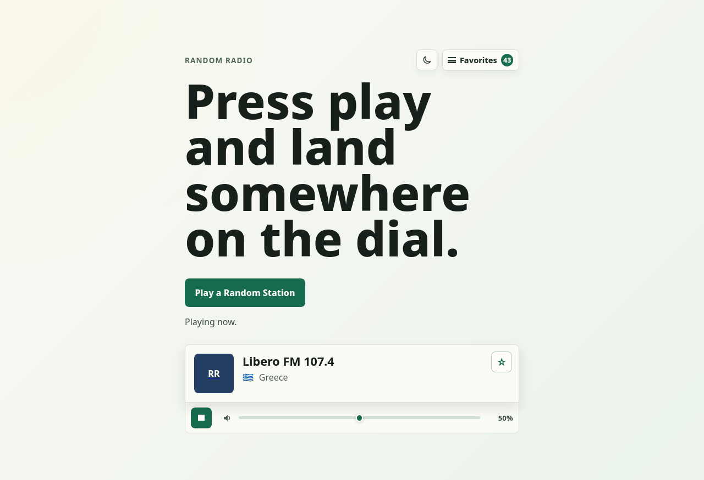

# Random Radio

Random Radio is a browser-based player for discovering live radio stations from around the world. Press play to tune in to a random station, save the ones you like, and return to your last-played station later.



Station data and stream URLs are provided by the [Radio Browser API](https://www.radio-browser.info/).

## Features

- Random live-radio discovery with automatic retries for unavailable streams
- Playback, volume, and mute controls
- Station details, including country and homepage links when available
- Favorites stored locally in the browser (up to 500 stations)
- Favorites import and export as JSON
- Last-played station and audio preferences remembered between visits
- Light and dark themes, with the initial theme based on the system preference
- Responsive, keyboard-accessible interface

## Getting started

### Prerequisites

- [Node.js](https://nodejs.org/) compatible with Angular 22
- npm 11 (the project is configured for npm 11.16.0)

Install the dependencies and start the development server:

```bash
npm install
npm start
```

Open [http://localhost:4200](http://localhost:4200). The development server reloads the app when source files change.

An internet connection is required to retrieve station data and play live streams. Some stations may be temporarily offline or may reject playback because of browser or stream-server restrictions.

## Available commands

| Command | Description |
| --- | --- |
| `npm start` | Start the local development server |
| `npm test` | Run the Vitest unit test suite |
| `npm run build` | Create an optimized production build in `dist/` |
| `npm run watch` | Rebuild continuously using the development configuration |
| `npm run ng -- <command>` | Run an Angular CLI command |

## How favorites are stored

Favorites, the last-played station, audio preferences, and the selected theme are saved in browser `localStorage`. No account or backend is required. Clearing site data removes these settings, so export favorites from the favorites menu before clearing browser storage if you want a backup.

Importing a favorites file merges new stations into the existing list and ignores duplicates. The app accepts only JSON files in its versioned Random Radio export format, with a maximum file size of 5 MB.

## Technology

- Angular 22 with standalone components and signals
- TypeScript 6
- RxJS 7
- Vitest 4
- Radio Browser API

## Production build

Create a deployable build with:

```bash
npm run build
```

The generated static files are written to `dist/random-radio/browser/` and can be served by any static hosting provider.

## License

Copyright (C) 2026 Mariano Esteban.

Random Radio is free software licensed under the [GNU General Public License, version 3 or later](LICENSE). If you distribute a modified version, you must make its corresponding source code available under the same license terms.
